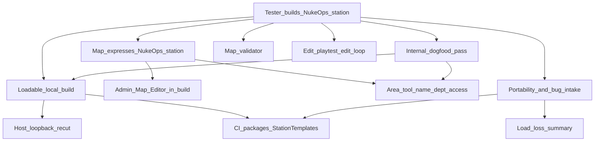

> Goal: A tester downloads a release, authors a map in a locally hosted build, playtests it in the same session, and hands it over; adopted maps ship in every release
> Status: in-progress
> Depends on: [test-server.md](test-server.md) T1 only (loadable build); feeds [mvp1-nuke-ops.md](mvp1-nuke-ops.md) M0 (the test station is this gate's acceptance map)
> Current focus: A7 (packaged client update/backup launch, tested with the v0.3.1 cut) and the A1/A3/A5 release-build checks, then the Discord tester announcement and A6
> Roadmap: Map authoring — Build your own station in a release build and hand it in

# Map authoring — tester-built maps

> **Expect a flood of gaps.** Map authoring in a player build is largely untested. A2.5 and A6 exist to surface bugs and missing pieces; triage them into new slices or **Explicitly deferred** as they arrive. A long open-issue list during A2.5/A6 is the gate working, not slipping.

## Playable definition

An **authoring** gate, separate from the operational [test-server.md](test-server.md) track and the gameplay [mvp1-nuke-ops.md](mvp1-nuke-ops.md) gate. Done when someone outside the project can:

- Download a release zip, run `Start_SS3D_Host.bat`, and open the Map Editor with no config editing (the host is ServerOwner via the shipped `Config/permissions.txt`)
- Author a map that expresses everything a Nuke Ops station needs: structure, furniture, items, pipes and cables; job + antag spawns; APCs and lights; **room name, department and access** (a vault is a Command room); nuke and disk placement. Air at round start comes free (every floor tile seeds station O₂/N₂, no-floor tiles are vacuum)
- Save, select the map, Start a round on it, play it alone or with LAN friends, Stop, and keep editing — without restarting the game and without silently losing edits or saving battle damage into the template
- Be told **before** a round starts when the map can't host it (missing required spawns, missing nuke/disk under Nuke Ops), and warned on save about softer problems
- Find the map file, hand it to devs or other testers, and file a usable bug report (logs + map `.json`)
- Load a map saved on an older release and be told what was dropped, never lose objects silently

A tester-built Nuke Ops station adopted into the release is the closing proof (A6), and becomes MVP1 M0's test-station map.

Uses the **admin Map Editor on a local host session** ([creative-mode.md](../design/creative-mode.md) §1, §2); a Builder gamemode is a later pass (§15). Maps are the same station templates every round loads (§9), with areas painted in the editor (§7).

## Dependency tree

Edges mean "needs." Leaves cite design / system maps / efforts — not full HOW.

- **Admin Map Editor in a build (shipped foundation)** — `MapEditorSubSystem`, admin-gated via `AdminMapEditorAuthorizer`; templates save to `Data/StationTemplates/<name>.json` next to the binary; Start restores the selected template ([tile](../architecture/systems/tile.md); [map-editor-creative-hooks](../architecture/systems/map-editor-creative-hooks.md); [rounds-lobby](../architecture/systems/rounds-lobby.md); [persistence](../architecture/systems/persistence.md)). Spawn Placements shipped ([2026-07_spawn-point-authoring.md](../archive/architecture/2026-07_spawn-point-authoring.md)). Air at start: `AtmosSimulation.InitCell` ([atmospherics](../architecture/systems/atmospherics.md)).
- **Loadable local build** — host loopback fix + re-cut is shared with [test-server.md](test-server.md) T1. `develop-release.yml` now packages `Data/Tilemaps/` and `Data/StationTemplates/` into Windows and Linux zips, requiring the default `ministation.json`; verify template loading on the next release cut ([2026-07_ci-develop-release-pipeline.md](../architecture/2026-07_ci-develop-release-pipeline.md)).
- **Area tool** — `MapEditorTool.Area` now selects or creates rooms and exposes name, department and access fields (manually accepted in the editor and dogfooded in a release build, A2.5) ([map-editor-creative-hooks](../architecture/systems/map-editor-creative-hooks.md)). `AreaSubSystem.RenameArea` / `SetParentTag` / `SetDefaultRequiredAccess` are called by the admin-checked editor path and persist through the existing area contributor; default access derives from the department tag (`AreaAccessDefaults`) ([area](../architecture/systems/area.md); [id-access](../architecture/systems/id-access.md)). Paint/erase line and rectangle strokes and APC-less room creation are implemented with undo; authored boundaries persist across loads and APC/geometry changes ([area-authoring](../architecture/systems/area-authoring.md)). The owner manually accepted the room authoring flow in the editor and dogfooded it in a release build (A2.5). An area is not a single placed object, so this stays within [creative-mode.md](../design/creative-mode.md) §3 (areas are set by editor fields). `AirLockAccessGate` uses room access first; legacy civilian/security prefab masks are fallbacks only outside assigned rooms. Per-door authoring remains deferred.
- **Map validator** — implemented: warnings on save and a complete blocking list before countdown for the selected gamemode. Compile, EditMode, PlayMode and lifecycle pilot passed in the implementing session; the save-report popover still needs visual review. Includes every offered job marker and nuclear operative/device/disk requirements, including Secret’s current nuclear mapping ([creative-mode.md](../design/creative-mode.md) §8: no silent failure reaches a round).
- **Edit loop** — editing happens in an Ongoing round. Admin Stop prompts **Save and stop / Discard / Cancel** when edits are unsaved; another round end writes a separate `<map>-autosave` template before station unload. Start restores the selected template from disk. Saving in-round captures the current station state; the original is protected on other round ends by using a separate autosave ([rounds-lobby](../architecture/systems/rounds-lobby.md); `MapEditorRoundStop.cs`).
- **Portability + bug intake** — one `.json` per map. **Save & Export** zips it into `Data/Exports/` and opens that folder; zips stay under Discord's upload limit even for MetaStation (~12 MB as JSON). **Open Maps Folder** (Load popover) opens `StationTemplates/`, where a dropped `.zip` or `.json` imports ([map-editor-creative-hooks](../architecture/systems/map-editor-creative-hooks.md)). `Builds/TESTERS.md` ships in the zips; `.github/ISSUE_TEMPLATE/MapBug.yml` applies the `map-authoring` label. Adoption checklist: validator clean, loads on the current schema, committed to `Builds/Game/Data/StationTemplates/`. **In-game bug report:** built. F8 opens the bug report dialog; in a local session it saves a bundle to `Data/Exports/` (report, logs, screenshot, optional current map with unsaved edits) and offers a pre-filled GitHub issue ([sandbox-server.md](../design/sandbox-server.md) §7; [ui-shell](../architecture/systems/ui-shell.md)). Used successfully in the owner's release-build dogfood.
- **Load-loss summary** — implemented: editor Load toasts the unknown objects it skipped (`TileMap.LastLoadSkipped`) ([tile](../architecture/systems/tile.md)). Round-start loads still only log. Schema migrations follow [2026-10_game-versioning.md](../architecture/2026-10_game-versioning.md).
- **Release updates** — Windows downloads include `Update_SS3D.bat`; Linux client downloads include `update_ss3d.sh` (Python 3). Stable numbered releases only, after owner promotion from prerelease. Both preserve local data and keep a runnable previous installation; packaged client update/rollback checks remain ([Windows updater](../architecture/2026-07_ci-develop-release-pipeline.md#windows-release-updates); [Linux updater](../architecture/2026-07_ci-develop-release-pipeline.md#linux-client-release-updates)).

## Slices

| Id | Name | Status | Links | Player view |
|----|------|--------|-------|-------------|
| A0 | Admin Map Editor in a local host build; structure, spawns, air at start | shipped | [tile](../architecture/systems/tile.md); [map-editor-creative-hooks](../architecture/systems/map-editor-creative-hooks.md); [atmospherics](../architecture/systems/atmospherics.md) | The in-game Map Editor works in a local build: walls, floors, spawns, air |
| A1 | Loadable local build: host loopback re-cut (shared with test-server T1) + CI packages `Data/StationTemplates/` | partial — **focus** (Config/Tilemaps packaging verified on `059e3dd`; StationTemplates packaging implemented, awaiting release verification) | [2026-07_ci-develop-release-pipeline.md](../architecture/2026-07_ci-develop-release-pipeline.md); [networking-session](../architecture/systems/networking-session.md); [test-server.md](test-server.md) T1 | The downloaded build loads, including the station templates |
| A2 | Area tool: room name, department tag, access override | shipped — painting, metadata, undo/redo, persistence and APC-facing membership; owner manually accepted in the editor | [area](../architecture/systems/area.md); [id-access](../architecture/systems/id-access.md); [map-editor-creative-hooks](../architecture/systems/map-editor-creative-hooks.md) | Paint rooms, name them, choose their department and control door access |
| A2.5 | Internal dogfood: a dev builds the Nuke Ops station in a release build before testers do; triage gaps into slices / deferred | shipped — owner dogfooded the map editor and other in-game systems in a release build (2026-11) and filed a report through the F8 dialog | this doc; [mvp1-nuke-ops.md](mvp1-nuke-ops.md) M0 | A developer builds the Nuke Ops station first and fixes what breaks |
| A3 | Map validator: warn on save, block Start on hard failures | partial — shared validator, save report and pre-countdown gate; compile, EditMode, PlayMode and lifecycle pilot pass in Unity; shipped maps carry the required markers; save-report popover not yet visually checked | [creative-mode.md](../design/creative-mode.md) §8; [rounds-lobby](../architecture/systems/rounds-lobby.md); [gamemodes-roles-traits](../architecture/systems/gamemodes-roles-traits.md) | The editor warns you about broken maps before you start a round |
| A4 | Edit loop: map edits happen in-round; unsaved-changes prompt on admin Stop, autosave to `<map>-autosave` on any other round end | shipped — lifecycle pilot covers prompt, Cancel, Discard, Save and stop and autosave | [rounds-lobby](../architecture/systems/rounds-lobby.md); [tile](../architecture/systems/tile.md) | Switching between editing and playing doesn't lose your work |
| A5 | Portability + intake: Open maps folder, load-loss summary, `TESTERS.md` in the zip, bug label, adoption checklist | partial — Save & Export (zip), zip import, Open Maps Folder, load-loss toast, `TESTERS.md` in both zips and the Map editor bug form implemented; EditMode passes; not yet checked in a release build | [persistence](../architecture/systems/persistence.md); [map-editor-creative-hooks](../architecture/systems/map-editor-creative-hooks.md); [2026-10_game-versioning.md](../architecture/2026-10_game-versioning.md) | Easy to find, share and hand in your map files, with a testers' guide in the download (export, import and the guide are in; release check pending) |
| A6 | Close: a tester builds the Nuke Ops station from a zip using only `TESTERS.md`; adopted as M0's map. Done = no blocker-severity issues open, not zero bugs | pending | depends A1–A5; [mvp1-nuke-ops.md](mvp1-nuke-ops.md) M0 | A tester builds the Nuke Ops station from the download using only the guide, and it becomes the official test map |
| A7 | Windows/Linux client stable-release updaters with preserved local data and rollback | partial — implemented and release packaging wired; isolated regression coverage and platform CI gates added; packaged client update/backup launches pending | [CI release pipeline](../architecture/2026-07_ci-develop-release-pipeline.md#windows-release-updates) | Close the game and run Update_SS3D.bat (Windows) or ./update_ss3d.sh (Linux) to get the latest stable release without losing maps; the previous build stays available |

Order: A1 → A2 → A2.5 → A3, A4, A5 in parallel → A6. A7's packaged update/rollback check is also required before the public map-building announcement.

## Explicitly deferred

- Builder gamemode with a single Builder role ([creative-mode.md](../design/creative-mode.md) §15).
- Per-door access override, and doing it through a diegetic airlock-electronics interface rather than an editor field ([creative-mode.md](../design/creative-mode.md) §3).
- Uploading maps to the test server (needs accounts; [test-server.md](test-server.md) defers them).
- Native Export/Import file dialogs (Unity players have none; would need a plugin).
- In-game authoring help / tutorial.
- Linux tester builds beyond best-effort; Windows is the required platform.
- Nuke / disk / vault **behaviour** — stays MVP1 M0/M3; this gate only makes them placeable and configurable.

## Maintenance

When child work ships, run `update-system-docs`: bump slice status + header `Current focus`, refresh [INDEX.md](INDEX.md). Keep A1 in sync with [test-server.md](test-server.md) T1. When A6 adopts a station, update MVP1 M0's map leaf. Gaps found during A2.5/A6 become new `A*` slices or deferred entries here; silent-failure bugs go into the owning system map's **Pitfalls**.
