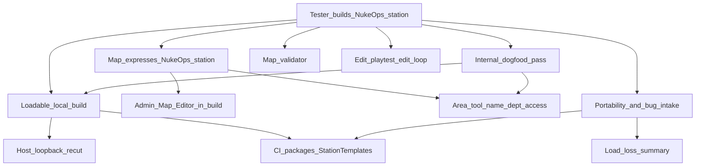

> Goal: A tester downloads a release, authors a map in a locally hosted build, playtests it in the same session, and hands it over; adopted maps ship in every release
> Status: in-progress
> Depends on: [test-server.md](test-server.md) T1 only (loadable build); feeds [mvp1-nuke-ops.md](mvp1-nuke-ops.md) M0 (the test station is this gate's acceptance map)
> Current focus: A1 (host loopback re-cut + CI packages `StationTemplates/`), A2 (Area tool: room name, department, access)
> Roadmap: Map authoring — Build your own station in a release build and hand it in

# Map authoring — tester-built maps

> **Expect a flood of gaps.** Map authoring in a player build is largely untested. A2.5 and A6 exist to surface bugs and missing pieces; triage them into new slices or **Explicitly deferred** as they arrive. A long open-issue list during A2.5/A6 is the gate working, not slipping.

## Playable definition

An **authoring** gate, separate from the operational [test-server.md](test-server.md) track and the gameplay [mvp1-nuke-ops.md](mvp1-nuke-ops.md) gate. Done when someone outside the project can:

- Download a release zip, run `Start_SS3D_Host.bat`, and open the Map Editor with no config editing (the host is ServerOwner via the shipped `Config/permissions.txt`)
- Author a map that expresses everything a Nuke Ops station needs: structure, furniture, items, pipes and cables; job + antag spawns; APCs and lights; **room name, department and access** (a vault is a Command room); nuke and disk placement. Air at round start comes free (every floor tile seeds station O₂/N₂, no-floor tiles are vacuum)
- Save, select the map, Start a round on it, play it alone or with LAN friends, Stop, and keep editing — without restarting the game and without silently losing edits or saving battle damage into the template
- Be told **before** a round starts when the map can't host it (missing required spawns, missing nuke/disk under Nuke Ops), and warned on save about softer problems
- Find the map file, hand it to devs or other testers, and file a usable bug report (logs + map `.json`)
- Load a map saved on an older release and be told what was dropped, never lose objects silently

A tester-built Nuke Ops station adopted into the release is the closing proof (A6), and becomes MVP1 M0's test-station map.

Uses the **admin Map Editor on a local host session** ([creative-mode.md](../design/creative-mode.md) §1, §2); a Builder gamemode is a later pass (§15). Maps are the same station templates every round loads (§9), with areas painted in the editor (§7).

## Dependency tree

Edges mean "needs." Leaves cite design / system maps / efforts — not full HOW.

- **Admin Map Editor in a build (shipped foundation)** — `MapEditorSubSystem`, admin-gated via `AdminMapEditorAuthorizer`; templates save to `Data/StationTemplates/<name>.json` next to the binary; Start restores the selected template ([tile](../architecture/systems/tile.md); [map-editor-creative-hooks](../architecture/systems/map-editor-creative-hooks.md); [rounds-lobby](../architecture/systems/rounds-lobby.md); [persistence](../architecture/systems/persistence.md)). Spawn Placements shipped ([2026-07_spawn-point-authoring.md](../archive/architecture/2026-07_spawn-point-authoring.md)). Air at start: `AtmosSimulation.InitCell` ([atmospherics](../architecture/systems/atmospherics.md)).
- **Loadable local build** — host loopback fix + re-cut is shared with [test-server.md](test-server.md) T1. `develop-release.yml` packages only `Data/Tilemaps/`, so `Builds/Game/Data/StationTemplates/` (including the default `ministation`) never reaches a zip ([2026-07_ci-develop-release-pipeline.md](../architecture/2026-07_ci-develop-release-pipeline.md)).
- **Area tool** — `MapEditorTool.Area` is reserved but has no UI ([map-editor-creative-hooks](../architecture/systems/map-editor-creative-hooks.md)). `AreaSubSystem.RenameArea` / `SetParentTag` / `SetDefaultRequiredAccess` exist and persist, but only tests call them; default access derives from the department tag (`AreaAccessDefaults`) ([area](../architecture/systems/area.md); [id-access](../architecture/systems/id-access.md)). Room-level config only: an area is not a single placed object, so this stays within [creative-mode.md](../design/creative-mode.md) §3 (areas are set by editor fields). `AirLockAccessGate`'s per-door override field is never set and stays unauthored.
- **Map validator** — warn on save, block Start with a list on hard failures for the selected gamemode ([creative-mode.md](../design/creative-mode.md) §8: no silent failure reaches a round).
- **Edit loop** — Start always reloads from disk, so unsaved edits are lost silently today; Start prompts Save and start / Discard / Cancel. Stop (or opening the editor after a round) reloads the saved template so round damage is never saved into it ([rounds-lobby](../architecture/systems/rounds-lobby.md)).
- **Portability + bug intake** — one `.json` per map: an **Open maps folder** button in Map Selection, import = drop a file in. `TESTERS.md` (extends the shipped `Builds/README.txt`) covers the flow, log location (`Game/Logs/`) and attaching the map file; the `map-authoring` label on `.github/ISSUE_TEMPLATE/Bug.yml`. Adoption checklist: validator clean, loads on the current schema, committed to `Builds/Game/Data/StationTemplates/`.
- **Load-loss summary** — unknown/removed tile SO names are skipped on load today with no tester-visible report ([tile](../architecture/systems/tile.md)); summarize drops on load. Schema migrations follow [2026-10_game-versioning.md](../architecture/2026-10_game-versioning.md).

## Slices

| Id | Name | Status | Links | Player view |
|----|------|--------|-------|-------------|
| A0 | Admin Map Editor in a local host build; structure, spawns, air at start | shipped | [tile](../architecture/systems/tile.md); [map-editor-creative-hooks](../architecture/systems/map-editor-creative-hooks.md); [atmospherics](../architecture/systems/atmospherics.md) | The in-game Map Editor works in a local build: walls, floors, spawns, air |
| A1 | Loadable local build: host loopback re-cut (shared with test-server T1) + CI packages `Data/StationTemplates/` | partial — **focus** (Config/Tilemaps packaging verified on `059e3dd`) | [2026-07_ci-develop-release-pipeline.md](../architecture/2026-07_ci-develop-release-pipeline.md); [networking-session](../architecture/systems/networking-session.md); [test-server.md](test-server.md) T1 | The downloaded build loads, including the station templates |
| A2 | Area tool: room name, department tag, access override | pending — **focus** | [area](../architecture/systems/area.md); [id-access](../architecture/systems/id-access.md); [map-editor-creative-hooks](../architecture/systems/map-editor-creative-hooks.md) | Mark out rooms: name, department and who has access (so a locked vault is possible) |
| A2.5 | Internal dogfood: a dev builds the Nuke Ops station in a release build before testers do; triage gaps into slices / deferred | pending | this doc; [mvp1-nuke-ops.md](mvp1-nuke-ops.md) M0 | A developer builds the Nuke Ops station first and fixes what breaks |
| A3 | Map validator: warn on save, block Start on hard failures | pending | [creative-mode.md](../design/creative-mode.md) §8; [rounds-lobby](../architecture/systems/rounds-lobby.md); [gamemodes-roles-traits](../architecture/systems/gamemodes-roles-traits.md) | The editor warns you about broken maps before you start a round |
| A4 | Edit loop: unsaved-changes prompt on Start; reload saved template on Stop | pending | [rounds-lobby](../architecture/systems/rounds-lobby.md); [tile](../architecture/systems/tile.md) | Switching between editing and playing doesn't lose your work |
| A5 | Portability + intake: Open maps folder, load-loss summary, `TESTERS.md` in the zip, bug label, adoption checklist | pending | [persistence](../architecture/systems/persistence.md); [2026-10_game-versioning.md](../architecture/2026-10_game-versioning.md) | Easy to find, share and hand in your map files, with a testers' guide in the download |
| A6 | Close: a tester builds the Nuke Ops station from a zip using only `TESTERS.md`; adopted as M0's map. Done = no blocker-severity issues open, not zero bugs | pending | depends A1–A5; [mvp1-nuke-ops.md](mvp1-nuke-ops.md) M0 | A tester builds the Nuke Ops station from the download using only the guide, and it becomes the official test map |

Order: A1 → A2 → A2.5 → A3, A4, A5 in parallel → A6.

## Explicitly deferred

- Builder gamemode with a single Builder role ([creative-mode.md](../design/creative-mode.md) §15).
- Per-door access override, and doing it through a diegetic airlock-electronics interface rather than an editor field ([creative-mode.md](../design/creative-mode.md) §3).
- Uploading maps to the test server (needs accounts; [test-server.md](test-server.md) defers them).
- Native Export/Import file dialogs (Unity players have none; would need a plugin).
- In-game authoring help / tutorial.
- Linux tester builds beyond best-effort; Windows is the required platform.
- Nuke / disk / vault **behaviour** — stays MVP1 M0/M3; this gate only makes them placeable and configurable.

## Maintenance

When child work ships, run `update-system-docs`: bump slice status + header `Current focus`, refresh [INDEX.md](INDEX.md). Keep A1 in sync with [test-server.md](test-server.md) T1. When A6 adopts a station, update MVP1 M0's map leaf. Gaps found during A2.5/A6 become new `A*` slices or deferred entries here; silent-failure bugs go into the owning system map's **Pitfalls**.
